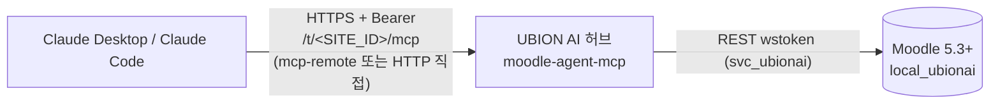
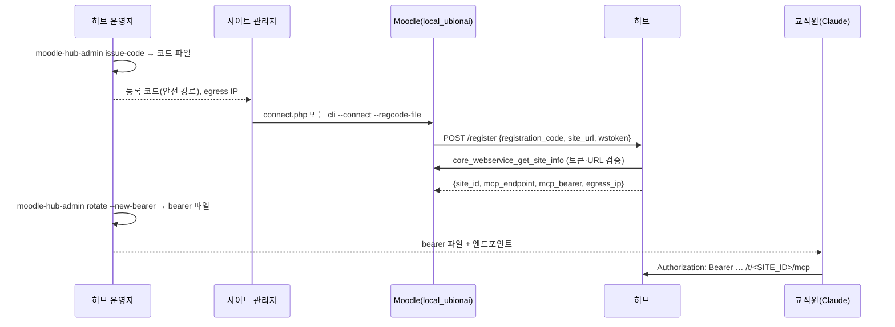

# Claude(Desktop / Code)를 UBION AI Moodle MCP에 연결하기

> 대상: Moodle 사이트 관리자(플러그인 설치·허브 등록), 허브 운영자(테넌트·자격증명 발급), 교직원(Claude 연결).
> 기준: `local_ubionai` 0.5.1 (`2026103106`, 커밋 `47cc0caa`), 허브 `moodle-agent-mcp` 소스. 작성일 2026-11-01.
> 근거 표기: `(plugin/파일:줄)` = 플러그인 repo, `(hub/파일:줄)` = 허브 repo. 코드로 확인되지 않은 내용은 **[미검증]** 으로 표시합니다.
> 이 문서에는 토큰·비밀값·실서버 주소가 없습니다. `<...>` 는 모두 바꿔 넣을 값입니다.

## 0. 역할 구분

| 역할 | 하는 일 |
|---|---|
| **허브 운영자** | 테넌트 등록 코드 발급(`issue-code`), Claude용 MCP bearer 발급(`rotate --new-bearer`), 가명화 설정, 테넌트 삭제·비활성화 (`hub/src/moodle_mcp/admin.py:72-120`) |
| **Moodle 사이트 관리자** | 플러그인 설치, Hub URL 설정, Connect·등록 코드 입력, IP 제한 (`plugin/connect.php:36-37`, `plugin/cli/connection.php`) |
| **교직원(Claude 사용자)** | 운영자에게 받은 MCP bearer로 Claude Desktop/Code 연결, 프롬프트로 사용 |

## 1. 구성



- **Moodle 쪽**: `local_ubionai` 가 웹서비스·REST 활성화, 서비스 사용자 `svc_ubionai`, 역할 `ubionai_service`, 외부 서비스 `ubionai`, 영구 토큰 1개를 만들고 허브에 등록 (`plugin/classes/local/provisioner.php:112-150`).
- **허브**: Moodle 토큰을 암호화 보관, 테넌트별 MCP 엔드포인트 `https://<HUB_HOST>/t/<SITE_ID>/mcp` 를 Bearer 인증으로 제공 (`hub/src/moodle_mcp/server.py:102`, `:1850-1858`). 도구 39개 (`hub/INSTALL.md:114`).
- **Claude 쪽**: ① `mcp-remote` 를 stdio 서버로 실행(권장, Desktop·Code 공통) 또는 ② Claude Code의 HTTP transport로 직접 연결.

## 2. 사전 요구사항

### 2.1 Moodle 사이트

- Moodle **5.3 LTS 이상** — `requires = 2026100500` (`plugin/version.php:29`, `plugin/README.md:7`). 5.1·5.2·4.5 미지원 (`hub/INSTALL.md:8`).
- 설치 위치: 5.3의 `public/` 구조 → `<MOODLE_ROOT>/public/local/ubionai` (`plugin/README.md:6`, `hub/INSTALL.md:27`).
- **PHP**: 플러그인 `version.php`·README에는 PHP 버전 명시 없음. 확인된 환경은 다음뿐:
  - CI: PHP **8.4** + `MOODLE_503_STABLE` (`plugin/.github/workflows/ci.yml:37-38`)
  - 설치 검증: PHP **8.3**-FPM + PostgreSQL 17 (`hub/INSTALL.md:8`, `hub/docs/INSTALL_VERIFICATION.md:8`)
  - 그 밖의 PHP 요구치는 Moodle 5.3 코어 요구사항을 따름 **[이 repo로는 미검증]**.
- Moodle 서버에서 허브로 **HTTPS 아웃바운드** 가능해야 함(등록 시 `POST <HUB_URL>/register`, 연결 10초·전체 30초 타임아웃, 리다이렉트 안 따름) (`plugin/classes/local/hub_client.php:200-214`).
- 허브에서 Moodle REST(`/webservice/rest/server.php`)로 **인바운드** 가능해야 함(등록 시 허브가 `core_webservice_get_site_info` 로 토큰 검증) (`hub/src/moodle_mcp/server.py:1541-1553`).
- 선택 플러그인: `mod_attendance`, `mod_openmaic` — 없으면 해당 도구만 `error`+`hint` (`hub/INSTALL.md:10`, `hub/src/moodle_mcp/server.py:107-109`).

### 2.2 허브 운영자에게 받을 것

| 받을 것 | 누가 받나 | 근거 |
|---|---|---|
| Hub URL (`https://<HUB_HOST>`) | 사이트 관리자 | `plugin/settings.php:50-53` |
| **1회용 등록 코드** (파일로, 기본 유효 24시간) | 사이트 관리자 | `hub/src/moodle_mcp/admin.py:57-59`, `:237-245` |
| 사이트 ID `<SITE_ID>` (소문자·숫자·`-`, 2~63자) | 사이트 관리자 | `hub/src/moodle_mcp/registry.py:32` |
| **허브 egress IP** `<HUB_EGRESS_IP>` (IP 제한을 걸 경우) | 사이트 관리자 | `hub/src/moodle_mcp/server.py:1933-1937`, `:1580` |
| 가명화(pseudonymize) on/off 정책 | 사이트 관리자·교직원 | `hub/src/moodle_mcp/admin.py:81-84`, `:92-95` |
| **MCP bearer** (파일로) | 교직원 | `hub/src/moodle_mcp/admin.py:186-196` |

- egress IP는 등록 성공 응답에도 들어 있고 상태 페이지에 표시됨. 단, **등록 전에** 알아야 IP 제한을 미리 걸 수 있음(4.4 참고).

### 2.3 Claude를 쓰는 PC

- **Node.js 20.18 이상** (`mcp-remote` 사용 시). Node 18은 `File is not defined` 로 종료 (`hub/INSTALL.md:14`, `hub/client/moodle-mcp-remote.sh:6-11`). Ubuntu 24.04 apt의 nodejs(18) 대신 nodejs.org/NodeSource 배포본.
- `mcp-remote` 버전 고정: `<MCP_REMOTE_VERSION>` (`hub/client/moodle-mcp-remote.sh:6`).
- 허브 인증서가 사설 CA면 `NODE_EXTRA_CA_CERTS=<CA_CERT_PATH>` (`hub/client/moodle-mcp-remote.sh:7`).

## 3. 다운로드

| 무엇 | 링크 | 비고 |
|---|---|---|
| 플러그인 repo | https://github.com/scottnaddle/moodle-local_ubionai | |
| 플러그인 main zip | https://github.com/scottnaddle/moodle-local_ubionai/archive/refs/heads/main.zip | 최신 main. 내용이 바뀔 수 있음 |
| 플러그인 커밋 고정 zip (0.5.1) | https://github.com/scottnaddle/moodle-local_ubionai/archive/47cc0caac87e95d9c7e400f855c2ce515313c6db.zip | 운영 설치에 권장 |
| 플러그인 v0.5.1 태그 zip | **아직 없음** | 태그·릴리스 0개(13절 갭 1) |
| 허브 repo (비공개) | https://github.com/scottnaddle/moodle-agent-mcp **(접근 권한 필요)** | 허브 운영자용. `client/moodle-mcp-remote.sh` 래퍼 포함 |

⚠️ zip을 풀면 `moodle-local_ubionai-main`(또는 `moodle-local_ubionai-47cc0caa…`) 폴더가 생김 → 반드시 **`ubionai`** 로 이름 변경. 다르면 Moodle이 인식 못 함.

```bash
unzip moodle-local_ubionai-main.zip
mv moodle-local_ubionai-main ubionai
```

## 4. 플러그인 설치·연결 (Moodle 사이트 관리자)

### 4.1 설치

1. `ubionai` 폴더를 `<MOODLE_ROOT>/public/local/ubionai` 에 둠.
2. 업그레이드: 사이트 관리 > 알림, 또는 `sudo -u <WEB_USER> php <MOODLE_ROOT>/admin/cli/upgrade.php --non-interactive` (`hub/INSTALL.md:29`).
3. 0.5.0 이하에서 올리는 경우 4.7(0.5.1 업그레이드 노트) 먼저 확인.

### 4.2 Connect가 만드는 것

*Connect*(웹) 또는 `--connect`(CLI)는 멱등이며 다음을 보장 (`plugin/classes/local/provisioner.php:112-150`):

- 웹서비스 활성화 + REST 프로토콜 추가 (`provisioner.php:117-122`)
- 서비스 사용자 **`svc_ubionai`**: manual 인증, 이름 `UbionAI Bot (service)`, 이메일 `svc_ubionai@example.invalid`, 무작위 비밀번호 (`provisioner.php:38-56`, `:322-347`)
- 역할 **`ubionai_service`**: **manager 아키타입 기본 권한 전체** + 추가 권한(`webservice/rest:use`, `moodle/course:create`, `moodle/role:assign`, `enrol/manual:enrol`, `moodle/grade:manage`, 배지, `moodle/course:view`, `mod/assign:view` 등), **시스템 컨텍스트**에 할당. editingteacher/teacher/student 역할 부여 허용 (`provisioner.php:65-80`, `:354-381`, `:132`)
- 외부 서비스 **`ubionai`**: 활성, `restrictedusers=1`(허가된 사용자만), 파일 업·다운로드 허용 (`provisioner.php:389-420`)
- 함수 연결: 코어/모드 함수 + `local_ubionai_*` 11개. 설치 안 된 함수(예: `mod_attendance_*`)는 건너뛰고 `skipped` 로 보고 (`provisioner.php:83-102`, `:431-454`)
- `svc_ubionai` 를 서비스에 허가(authorise) (`provisioner.php:463-481`)
- **영구 토큰 정확히 1개**(이름 `ubionai-mcp`): 추적 중인 유효 토큰이 있으면 재사용(`reused`), 없으면 새로 발급(`created`), 추적 안 되는 유효 `ubionai-mcp` 토큰이 이미 있으면 그건 두고 새로 발급(`rotated`) (`provisioner.php:516-569`)
- 토큰 문자열은 어떤 API·화면·로그·config에도 나오지 않음. 추적은 토큰 행 id만(`issued_token_ids`) (`plugin/README.md:200-207`, `:232-234`)

> ⚠️ 화면 경고 그대로: "manager 아키타입 역할의 서비스 사용자와 **영구** 토큰을 만든다. CLI로 지정하지 않으면 IP 제한 없음" (`plugin/lang/en/local_ubionai.php:70`, `plugin/connect.php:159-160`).

> ❌ **admin 계정 토큰, `moodle_mobile_app` 서비스 토큰을 허브·MCP에 쓰지 말 것.** 전용 사용자·전용 역할·`restrictedusers=1` 서비스만 사용 (`hub/INSTALL.md:118`, `hub/docs/moodle-grokbot-integration-2026-10-31.md:84`). 플러그인은 등록 시 자기가 발급한 `svc_ubionai` 토큰만 허브로 보냄 (`plugin/classes/local/hub_client.php:71-77`).

### 4.3 Hub URL 설정

- 사이트 관리 > 플러그인 > 로컬 플러그인 > *UBION AI connection* > `Hub URL` (`plugin/settings.php:49-54`).
- `https://` 로 시작해야 함. 사용자정보·쿼리·프래그먼트 금지. 비워 두면 허브 등록 없이 로컬 웹서비스만 구성 (`plugin/settings.php:39-45`, `plugin/classes/local/hub_client.php:149-168`).

### 4.4 웹에서 연결: `/local/ubionai/connect.php`

- 권한: `local/ubionai:manageconnection`(기본 부여 아키타입 없음 → 사이트 관리자) (`plugin/connect.php:36-37`, `plugin/db/access.php:28-33`).
- Hub URL이 설정되고 아직 미등록이면 *Connect* 버튼 대신 **등록 코드 입력 폼**(비밀번호 마스킹 필드) 표시 (`plugin/connect.php:215-220`, `plugin/classes/form/connect_form.php:41-46`).
- 코드 입력 후 *Connect* → 로컬 프로비저닝 → `POST <HUB_URL>/register` (`plugin/connect.php:45-62`).
- 웹 화면의 옵션은 **등록 코드 하나뿐**. `--iprestriction`·`--revoke-legacy` 는 **CLI 전용** (`plugin/connect.php:46` 은 인자 없이 `provision()` 호출).
- 등록 성공 시 상태 표에 **허브 사이트 ID, 등록 시각, MCP 엔드포인트, 허브 egress IP** 표시 (`plugin/connect.php:191-198`). egress IP가 있으면 "IP 제한이 필요하면 `--iprestriction` 에 허용하라"는 안내 표시 (`plugin/connect.php:64-68`, `lang:94`).
- 허브가 돌려준 MCP bearer는 Moodle에 **암호화 저장, 화면 미표시** (`plugin/classes/local/hub_client.php:132-137`).
- *Disconnect*: 플러그인이 발급·추적한 토큰만 삭제, 사용자·역할·서비스는 유지, 허브 등록 정보 삭제. **허브의 테넌트는 지우지 않음** → 재등록 전 운영자가 테넌트 삭제 필요(안 하면 `already_registered`/409) (`plugin/connect.php:100-127`, `plugin/README.md:207-212`).

### 4.5 CLI: `cli/connection.php` 옵션 전부

웹 서버 사용자로 실행. 스크립트가 `__DIR__/../../../config.php` 를 읽으므로 절대 경로로 실행 가능 (`plugin/cli/connection.php:31`).

```bash
sudo -u <WEB_USER> php <MOODLE_ROOT>/public/local/ubionai/cli/connection.php --status
```

| 옵션 | 의미 | 근거 |
|---|---|---|
| `--status` | 상태 출력(키: 값) | `connection.php:110-122` |
| `--connect` | 프로비저닝(4.2) | `connection.php:123-145` |
| `--disconnect` | 추적 토큰 삭제, `tokensdeleted`/`tokensuntracked` 출력 | `connection.php:157-163` |
| `--iprestriction=<IP[,IP|CIDR...]>` | 서비스 허가 + 토큰에 IP 제한 (`--connect` 전용) | `connection.php:66-69`, `:124-130` |
| `--regcode-file=<PATH>` | 파일 첫 줄(최대 1 KiB)을 등록 코드로. 일반 파일만, 그룹/기타 읽기 가능하면 경고 | `connection.php:81-104` |
| `--regcode-file=-` | stdin에서 읽음(히스토리에 안 남음) | `connection.php:84-85` |
| `--regcode=<VALUE>` | 허용되나 프로세스 목록·셸 히스토리에 노출, 경고 출력 | `connection.php:77-80`, `lang:106` |
| `--revoke-legacy` | 추적 안 되는 `ubionai-mcp` 토큰(svc_ubionai·서비스 ubionai, 만료 여부 무관) 삭제 (`--connect` 전용) | `connection.php:70-73`, `plugin/README.md:228-230` |
| `-h`, `--help` | 사용법 | `connection.php:35`, `:47-50` |

- `--status`·`--connect`·`--disconnect` 중 **정확히 하나**. `--regcode` 와 `--regcode-file` 동시 사용 불가. 위반 시 종료 코드 2 (`connection.php:45-73`).
- 종료 코드: `0` 성공, `2` 사용법 오류·잘못된 `--iprestriction`, `3` 프로비저닝은 됐으나 허브 등록 실패, `1` 기타 예외 (`connection.php:53`, `:127-128`, `:153-155`, `:165-166`).
- 등록 코드는 출력되지 않음. 등록 결과는 `hub_status:`·`hub_siteid:` 로 출력 (`connection.php:147-152`).

권장 순서(IP 제한 + 등록 한 번에):

```bash
# 코드 파일을 운영자에게 안전하게 받은 경우
sudo -u <WEB_USER> php <MOODLE_ROOT>/public/local/ubionai/cli/connection.php \
  --connect --iprestriction=<HUB_EGRESS_IP> --regcode-file=<REGCODE_FILE>
# 또는 붙여 넣기(stdin)
sudo -u <WEB_USER> php <MOODLE_ROOT>/public/local/ubionai/cli/connection.php \
  --connect --iprestriction=<HUB_EGRESS_IP> --regcode-file=-
```

### 4.6 `--iprestriction` 규칙

- 쉼표로 구분한 IPv4/IPv6 주소 또는 **엄격한 CIDR**. 공백 제거·정규화·중복 제거 후 최대 255자. 호스트 비트가 있는 CIDR, zone id, 호스트명은 거부(종료 코드 2) (`plugin/README.md:273-276`, `plugin/classes/local/ip_validator.php`).
- 서비스 허가(`external_services_users`)와 토큰(`external_tokens`) 둘 다에 적용 (`provisioner.php:478-480`, `:540-541`, `:558`).
- 넣을 값은 **Moodle이 보는 허브의 접속 IP** = 허브 egress IP (`hub/INSTALL.md:43`, `lang:94`).
- ⚠️ **등록 전에** 걸 것: 등록 시 허브가 그 토큰으로 Moodle을 호출하므로, egress IP가 빠져 있으면 등록이 `registration_failed` 로 실패 (`hub/src/moodle_mcp/server.py:1541-1545`, `plugin/classes/local/hub_client.php:87-88`).
- ⚠️ 빈 값으로 다시 `--connect` 해도 **기존 IP 제한은 지워지지 않음**(값이 있을 때만 갱신) (`provisioner.php:478`, `:540`). 해제하려면 Moodle 관리 화면에서 직접 수정(13절 갭).

### 4.7 0.5.1 업그레이드 노트

- 데이터 변경 없음 (`plugin/README.md:238`).
- Connect가 더 이상 추적 안 되는 `ubionai-mcp` 토큰(예: 허브 repo의 `setup_ubionai_ws.php --token-file` 로 만든 것)을 **채택하지 않음**. 허브용 토큰을 새로 발급(`token_action: rotated`)하고 기존 토큰은 그대로 둠, *Disconnect* 도 안 지움 (`plugin/README.md:238-243`, `provisioner.php:546-568`).
- 그 기존 토큰을 더 쓰지 않으면 한 번 실행: `php .../cli/connection.php --connect --revoke-legacy` (`plugin/README.md:242-243`, `lang:78`).
- 0.5.0에서 `token_action: adopted` 가 나왔었다면, 그 토큰이 허브가 가진 토큰이고 구분 불가 → 필요 시 setup 스크립트 토큰 재발급 → *Disconnect* → *Connect* → 운영자가 테넌트 삭제 후 재등록 (`plugin/README.md:245-248`).
- `local_ubionai_list_course_assignments` 는 시스템 컨텍스트 `moodle/course:view` 없는 호출자에게 `total: null` 반환(서비스 역할은 보유) (`plugin/README.md:250-253`).

## 5. 테넌트 엔드포인트와 자격증명 흐름

### 5.1 엔드포인트

- 허브(멀티테넌트): `https://<HUB_HOST>/t/<SITE_ID>/mcp` — 경로는 정규식 `^/t/([a-z0-9][a-z0-9-]{1,62})/mcp/?$` (`hub/src/moodle_mcp/server.py:102`, `:1578`).
- 단일 서버 모드: `https://<MCP_HOST>/mcp`, bearer는 서버의 `MCP_BEARER_TOKEN` (`server.py:1899-1910`).
- 헬스체크: `GET|HEAD /health`, `/healthz` → `{"status":"ok"}`, **인증 불필요** (`server.py:1808-1810`, `:1416-1418`).
- 그 외 경로(OAuth 메타데이터 포함)는 `404` (`server.py:1827-1829`).

### 5.2 흐름



- **등록 코드(1회용)**: 운영자 `moodle-hub-admin issue-code --site-id <SITE_ID> --moodle-url <WWWROOT> [--ttl <N[s|m|h|d]>] --out <FILE>`. 기본 TTL 86400초, 출력 파일이 이미 있으면 거부 (`hub/src/moodle_mcp/admin.py:57-68`, `:113-117`, `:237-245`).
- 플러그인은 코드 형식 `[A-Za-z0-9_-]{16,128}` 만 받음, 저장·로그·URL에 안 남김 (`plugin/classes/local/hub_client.php:64-68`, `plugin/README.md:195-196`).
- 허브 `/register` 검증 (`hub/src/moodle_mcp/server.py:1485-1582`):
  - 코드 유효·미사용 + `site_url` 이 코드 발급 때의 `--moodle-url` 과 같아야 함(아니면 403)
  - 같은 `site_id` 테넌트가 이미 있으면 409
  - 받은 wstoken으로 `core_webservice_get_site_info` 호출, `siteurl` 일치해야 함(아니면 400)
  - 새 bearer 생성 → 테넌트 저장 → 코드 소진 → 응답
- **Claude용 bearer**: 등록 응답의 bearer는 플러그인에 암호화 저장되고 표시되지 않음. 교직원용은 운영자가 발급:
  `moodle-hub-admin rotate --site-id <SITE_ID> --new-bearer --bearer-out <FILE>` (`hub/src/moodle_mcp/admin.py:186-196`).
  - 테넌트당 bearer는 **1개**(해시 1개 저장) → 회전 시 **이전 bearer(플러그인 저장분 포함) 즉시 무효** (`hub/src/moodle_mcp/registry.py:325-331`, `:360-361`).
- 운영자 기타 명령 (`hub/src/moodle_mcp/admin.py:75-120`):
  - `add`(코드 없이 직접 등록, `--moodle-token-file`·`--bearer-out` 필수)
  - `rotate`(`--moodle-token-file`, `--litellm-key-file`, `--new-bearer --bearer-out`, `--pseudonymize|--no-pseudonymize`, `--assignment-title-heuristic`)
  - `disable`/`enable`(비활성 테넌트는 bearer 검증 실패 → 403, `registry.py:327`)
  - `list [--json]`(메타데이터만), `delete --yes`, `purge-pseudonyms`
  - 환경변수 `UBIONAI_HUB_DB`, `UBIONAI_HUB_KEK_FILE` 필요 (`admin.py:147`)

### 5.3 bearer 보관 (교직원 PC)

```bash
mkdir -p ~/.config/moodle-mcp
(umask 077; cat > ~/.config/moodle-mcp/token)   # 붙여 넣고 Enter, Ctrl-D (히스토리에 안 남음)
chmod 600 ~/.config/moodle-mcp/token
```

- 허브 래퍼는 600/400이 아니면 실행 거부 (`hub/client/moodle-mcp-remote.sh:15-16`).

## 6. 허브 transport·auth (코드 확인 결과)

- **Streamable HTTP**, `stateless_http=True`, `json_response=True`, 경로 `/mcp`(테넌트 경로를 내부에서 `/mcp` 로 재작성) (`hub/src/moodle_mcp/server.py:338-349`, `:1876-1877`).
- 인증은 **정적 Bearer 헤더만**. `Authorization: Bearer <token>` — 스킴은 정확히 `Bearer`, 공백 1개, 토큰 안에 공백 불가 (`server.py:1438-1455`).
  - 헤더 없음/형식 오류 → `401` + `WWW-Authenticate: Bearer` (`server.py:1852-1855`)
  - bearer 불일치·테넌트 비활성 → `403` (`server.py:1856-1859`)
- **OAuth 없음**(인가 서버·메타데이터 엔드포인트 없음 → 404) (`server.py:1806-1829`).
- 결론: `mcp-remote --transport http-only` 와 Claude Code `--transport http` + `--header` **둘 다 프로토콜상 가능**. claude.ai/Desktop의 *원격 커스텀 커넥터*(OAuth 기반)는 불가(13절 갭).

## 7. Claude Code

### 7.1 방식 A (권장): stdio + mcp-remote

토큰은 실행 시점에 파일에서 읽어 환경변수로만 넘김(설정 파일·argv에 토큰 없음).

```bash
claude mcp add moodle --scope user \
  --env MCP_URL='<MCP_ENDPOINT_URL>' \
  --env MCP_TOKEN_FILE='<ABSOLUTE_PATH_TO_TOKEN_FILE>' \
  --env MCP_REMOTE_VERSION='<MCP_REMOTE_VERSION>' \
  -- /bin/sh -c 'AUTH_HEADER="Bearer $(tr -d "\r\n" < "$MCP_TOKEN_FILE")"; export AUTH_HEADER; exec npx -y "mcp-remote@$MCP_REMOTE_VERSION" "$MCP_URL" --transport http-only --header "Authorization:\${AUTH_HEADER}"'
claude mcp get moodle
```

- `${AUTH_HEADER}` 는 mcp-remote가 직접 치환 (`hub/client/moodle-mcp-remote.sh:17-20`).
- 허브 repo 접근 권한이 있으면 `-- <ABSOLUTE_PATH>/client/moodle-mcp-remote.sh` 로 대체 가능(권한 600 검사·Node 버전 검사 포함) (`hub/client/moodle-mcp-remote.sh:9-16`).
- 예시 스크립트: [claude-code-mcp-add.example.sh](https://raw.githubusercontent.com/scottnaddle/moodle-local_ubionai/docs/claude-mcp-connect/docs/claude/claude-code-mcp-add.example.sh)

### 7.2 방식 B: HTTP 직접 (`--transport http` + `--header`)

허브가 Streamable HTTP + 정적 Bearer라서 직접 연결도 됨(6절). **토큰을 명령에 직접 쓰지 말고 환경변수 참조를 작은따옴표로** 넣음.

```bash
# 1) 등록: 작은따옴표 → ${MOODLE_MCP_TOKEN} 가 문자 그대로 저장됨
claude mcp add --transport http --scope user moodle '<MCP_ENDPOINT_URL>' \
  --header 'Authorization: Bearer ${MOODLE_MCP_TOKEN}'
# 2) 실행할 때마다: 파일에서 환경변수로 읽고 claude 실행
MOODLE_MCP_TOKEN="$(tr -d '\r\n' < <ABSOLUTE_PATH_TO_TOKEN_FILE>)" claude
```

- 확인 내용(Claude Code 2.1.314, 가짜 로컬 서버에 더미 값): 설정에는 `Bearer ${MOODLE_MCP_TOKEN}` 가 그대로 저장되고, 요청 시 환경변수 값으로 치환되어 전송됨(local scope). `--scope project` 는 `.mcp.json` 에 같은 형태로 저장되며 첫 실행 때 승인 필요.
- ❌ `--header "Authorization: Bearer <실제토큰>"`(큰따옴표·실값) 금지 — 셸 히스토리와 `~/.claude.json`(또는 `.mcp.json`)에 평문으로 남음.
- 환경변수가 비어 있으면 `Bearer ` 만 전송 → 허브가 `401` (`hub/src/moodle_mcp/server.py:1451-1455`).

### 7.3 scope

- `local`(기본, 이 프로젝트·나만), `project`(`.mcp.json` 팀 공유 — 경로·변수명만, 토큰 금지), `user`(모든 프로젝트) (`claude mcp add --help`).

## 8. Claude Desktop

1. Claude Desktop > Settings > Developer > *Edit Config*
   - macOS: `~/Library/Application Support/Claude/claude_desktop_config.json`
   - Windows: `%APPDATA%\Claude\claude_desktop_config.json`
2. 예시의 `mcpServers.moodle` 을 붙여 넣고 `<...>` 채움: [claude_desktop_config.example.json](https://raw.githubusercontent.com/scottnaddle/moodle-local_ubionai/docs/claude-mcp-connect/docs/claude/claude_desktop_config.example.json)

   ```json
   {
     "mcpServers": {
       "moodle": {
         "command": "/bin/sh",
         "args": ["-c", "<예시 파일의 한 줄 스크립트 그대로>"],
         "env": {
           "MCP_URL": "<MCP_ENDPOINT_URL>",
           "MCP_TOKEN_FILE": "<ABSOLUTE_PATH_TO_TOKEN_FILE>",
           "MCP_REMOTE_VERSION": "<MCP_REMOTE_VERSION>",
           "NPX": "<ABSOLUTE_PATH_TO_NPX>"
         }
       }
     }
   }
   ```

   - `MCP_TOKEN_FILE`: 절대 경로(`~` 불가). `NPX`: `which npx` 의 절대 경로(Desktop 앱은 셸 PATH를 물려받지 않음).
   - 설정 파일에는 **토큰이 아니라 토큰 파일 경로만**.
3. Desktop 완전 종료 후 재실행 → 도구 목록에 `moodle` 도구가 보이면 성공.
4. 허브 repo 권한이 있으면 `command` 에 `client/moodle-mcp-remote.sh` 절대 경로, `env` 에 `MCP_URL`·`MCP_TOKEN_FILE` 만 넣어도 됨 (`hub/INSTALL.md:100-103`).

> Windows: 예시는 `/bin/sh` 기반이라 그대로는 동작 안 함 → WSL 사용 또는 운영자에게 Windows용 래퍼 요청(13절 갭).

## 9. 동작 확인

| 확인 | 방법 | 정상 결과 |
|---|---|---|
| 허브 살아 있음 | `curl -fsS https://<HUB_HOST>/healthz` | `{"status": "ok"}` (인증 불필요, `hub/src/moodle_mcp/server.py:1808-1810`) |
| Moodle 쪽 상태 | `php .../cli/connection.php --status` | `webservices_enabled: Yes`, `rest_enabled: Yes`, `user_authorised: Yes`, `token_valid: Yes`, `tokens_tracked: 1`, `hub_registered: Yes`, `hub_mcp_endpoint: https://<HUB_HOST>/t/<SITE_ID>/mcp` (`plugin/classes/local/provisioner.php:285-314`) |
| Claude Code 등록 | `claude mcp list` / `claude mcp get moodle` | `moodle` 이 Connected (실패 시 HTTP 상태와 사유 표시) |
| Claude Code 세션 | 대화창에서 `/mcp` | `moodle` connected, 도구 39개 |
| 도구 호출 | "moodle 도구로 site_info 보여 줘" | 사이트 이름 + 사용자 `svc_ubionai` (`hub/src/moodle_mcp/server.py:454-457`) |

- 상태 키 의미: `tokens_untracked` > 0 이면 플러그인이 발급하지 않은 토큰이 남아 있음(4.7) (`plugin/connect.php:150-154`).
- 운영 점검용(허브 운영자): `MCP_URL=<MCP_ENDPOINT_URL> MCP_BEARER_TOKEN_FILE=<FILE> python3 scripts/smoke_test.py` → 기대 `list_tools: 39 tools` (`hub/INSTALL.md:106-114`). 이 스크립트는 Claude 연결 확인이 아니라 **허브 직접 점검**용.

## 10. 예시 프롬프트와 쓰기 안전 모델

### 10.1 읽기

- "내 Moodle 강좌 목록 보여 줘" → `list_courses` (`core_course_get_courses`) (`server.py:459-463`)
- "강좌 <COURSE_ID> 구성(섹션·활동) 보여 줘" → `get_course_outline` (`server.py:465-468`)
- "과제 목록과 제출 현황" → `list_assignments`, `get_submissions` (`server.py:476-490`, `:615-618`)

### 10.2 과제 생성 (미리보기 → 승인 → 실행)

```
강좌 <COURSE_ID> 의 1번 섹션에 "1주차 에세이" 과제를 만들어 줘.
온라인 텍스트 제출, 만점 100, 마감 <DATE>. 먼저 미리보기만 보여 줘.
```

- `create_assignment(..., confirm=false)` → Moodle 호출 없이 `{"preview": true, "module": {...}, "note": "Nothing changed. Re-call with confirm=true."}` (`server.py:751-760`, `:114`, `:776-807`).
- 미리보기 확인 후 "좋아, 만들어 줘" → `confirm=true` 로 재호출 → `local_ubionai_create_module` 실행 (`server.py:761-762`, `:770-774`).
- 날짜 인자는 unix timestamp (`server.py:778`).

### 10.3 채점 + 피드백 (`grade_submission`)

```
과제 <ASSIGNMENT_ID> 의 제출물을 보여 줘. (확인 후) [이름_xxxxxxxx] 학생에게 85점,
피드백 "논지가 명확합니다"로 채점해 줘.
```

- `grade_submission(assignment_id, user_id, grade, feedback_text, ...)` → `mod_assign_save_grade`, 피드백은 코멘트 플러그인으로 저장 (`server.py:713-733`).
- ⚠️ **`grade_submission`·`bulk_grade` 에는 `confirm` 미리보기 단계가 없음** — 호출 즉시 저장. 설명에 `WRITE_NOTE`("선생님이 확인한 뒤에만 호출")만 붙어 있음 (`server.py:713-749`). → 프롬프트에서 **"점수·피드백 목록을 먼저 보여 주고 내가 승인하면 저장"** 을 명시할 것.

### 10.4 쓰기 안전 모델 (코드 기준)

- `WRITE_NOTE = "WRITE - only call after the teacher confirmed."` — 쓰기 도구 설명 앞에 붙는 **문구**(서버가 강제하지 않음) (`server.py:112`).
- `CONFIRM_NOTE` — `confirm=false` 로 먼저 미리보기, 승인 후 `confirm=true` (`server.py:113`). `confirm` 인자(기본 `false`)를 받는 도구 23개: `create_*` 12개, `set_*` 6개, `update_activity`, `update_section`, `add_quiz_questions`, `add_sections`, `post_forum_discussion` (`server.py:664-694`, `:751-762`, `:776-1355`).
- 미리보기 단계 **없는** 쓰기 도구: `grade_submission`, `bulk_grade` (`server.py:713-749`).
- 서버 지시문: "WRITE 도구는 미리보기 후 교사가 명시적으로 확인했을 때만 실제 호출" (`server.py:340-344`) — LLM 행동 지침이지 서버 강제가 아님.
- **권한**: 모든 호출은 Moodle에서 `svc_ubionai`(manager 아키타입 + 추가 권한, 시스템 컨텍스트) 권한으로 실행됨. Claude를 쓰는 **교직원 개인의 Moodle 권한은 적용되지 않음** (`provisioner.php:65-80`, `:354-381`; 허브는 테넌트 토큰 하나로 호출, `server.py:1861-1869`). 각 함수의 capability 검사는 svc_ubionai 기준 (`plugin/README.md:11-12`).
- `create_course` 는 생성 후 svc_ubionai를 editingteacher(기본 roleid 3, `MOODLE_EDITINGTEACHER_ROLE_ID`)로 등록 (`server.py:111`, `:664-711`).
- 처음엔 **테스트 강좌**에서만 시험.

### 10.5 `smoke_test.py --write` 와의 구분

- `hub/scripts/smoke_test.py` 는 허브 운영자의 **배포 점검 스크립트**. `--write` 는 이 스크립트의 옵션으로 `MCP-SMOKE-<ts>` 강좌·섹션·페이지·과제를 실제로 만듦(끝나면 수동 삭제) (`hub/scripts/smoke_test.py:1-19`, `:59-68`, `hub/INSTALL.md:110-114`).
- Claude의 `confirm` 미리보기 흐름과는 **무관**. 교직원이 실행할 필요 없음.

## 11. PII 가명화

- 허브 모드에서 테넌트별로 켜고 끔. **기본 켜짐**(등록·`add` 모두) (`hub/src/moodle_mcp/registry.py:64`, `:283`, `hub/src/moodle_mcp/admin.py:84`).
  - 변경: `moodle-hub-admin rotate --site-id <SITE_ID> --pseudonymize|--no-pseudonymize` (`admin.py:92-95`, `:178-180`)
  - 과제 제목 휴리스틱: `--assignment-title-heuristic full|title|off`(기본 `title`) (`admin.py:96-98`, `registry.py:66`, `hub/src/moodle_mcp/pseudonym.py:77-78`)
- **단일 서버 모드**에는 가명화 없음(테넌트 라우터에서만 적용) (`hub/src/moodle_mcp/server.py:1899-1910`, `:1870-1875`).
- 자리표시자 형식: `[이름_xxxxxxxx]`, `[학번_xxxxxxxx]`, `[이메일_…]`, `[전화번호_…]`, `[주민번호_…]` (8자리 16진수) (`pseudonym.py:3-4`, `:48-54`, `:378`).
- 이름은 사용자 객체의 `firstname/lastname/fullname/username` 등 필드 + 한국어 이름 휴리스틱, 학번·이메일·전화·주민번호는 정규식으로 마스킹 (`pseudonym.py:55-60`, `:329-337`).
- **쓰기 시 실명 복원**: Claude가 보낸 인자 안의 자리표시자를 허브가 원래 값으로 되돌려 Moodle에 전송(예: 피드백 문구 안의 `[이름_…]`) (`server.py:427-429`, `hub/tests/test_server_pseudonym.py:76-111`).
- 복원 못 한 자리표시자가 남은 **쓰기**는 Moodle 호출 없이 `{"error": "unresolved placeholders"}` 로 거부, 미리보기에는 `unresolved_placeholders` 표시 (`server.py:430-436`, `:755-759`).
- 매핑은 암호화 저장, 기본 보존 86400초(`UBIONAI_HUB_PSEUDONYM_TTL`) → 오래된 대화의 자리표시자는 복원 실패할 수 있음 (`hub/src/moodle_mcp/registry.py:35-42`).
- 교직원 안내: 학생 이름이 `[이름_…]` 로 보이는 것이 **정상**. 그대로 Claude에게 지시하면 됨(실명으로 바꿔 쓸 필요 없음).

## 12. 문제 해결

| 증상 | 원인 / 조치 | 근거 |
|---|---|---|
| `401 unauthorized` | Authorization 헤더 없음·형식 오류(`Bearer` 철자, 공백, 빈 토큰). 토큰 파일 경로·권한·환경변수 확인 | `server.py:1438-1455`, `:1852-1855` |
| `403 forbidden` (MCP) | bearer 불일치(회전됨), `<SITE_ID>` 다름, 테넌트 `disable` 상태 → 운영자에게 확인·재발급 | `server.py:1856-1859`, `registry.py:325-331` |
| `404 not found` | 경로 오류. 허브 `/t/<SITE_ID>/mcp`, 단일 서버 `/mcp` | `server.py:1827-1829` |
| 등록 `code_rejected` | 코드 무효·만료(기본 24h)·사용됨·`--moodle-url` 불일치 → 새 코드 | `hub_client.php:90-91`, `lang:84`, `server.py:1523-1536` |
| 등록 `already_registered` | 허브에 테넌트 존재 → 운영자 `delete --site-id <SITE_ID> --yes` 후 새 코드 | `hub_client.php:93-94`, `server.py:1537-1539` |
| 등록 `registration_failed` | 허브가 wstoken으로 Moodle 호출 실패: **IP 제한에 허브 egress IP 누락**, 허브→Moodle 접속 불가, `siteurl` 불일치 | `hub_client.php:87-88`, `server.py:1541-1553` |
| 등록 `invalid_code` / `invalid_hub_url` / `hub_unreachable` | 코드 형식(16~128자 `[A-Za-z0-9_-]`) / Hub URL https·형식 / 네트워크·TLS | `hub_client.php:59-68`, `:82-83`, `lang:82-89` |
| `token_valid: No` | 추적 토큰이 삭제·만료됨. `--connect` 로 새 토큰 발급되지만 **허브는 옛 토큰 보유** → 토큰 문자열을 꺼낼 방법이 없으므로 운영자 테넌트 삭제 → 새 코드로 재등록(새 bearer 발급, 교직원 bearer도 재발급 필요) | `provisioner.php:264-270`, `:551-568`, `README.md:232` |
| 모든 도구가 Moodle `error` (등록 이후 IP 변경 등) | 허브 egress IP가 `--iprestriction` 에 없음 → `--connect --iprestriction=<기존 값>,<HUB_EGRESS_IP>` (값이 통째로 교체되므로 기존 IP 포함) | `provisioner.php:478-480`, `:540-541`, `moodle.py:104-107` |
| 특정 도구 `error` + `hint`(optional plugin) | `mod_attendance`/`mod_openmaic`/`local_ubionai` 함수 없음 또는 서비스 미연결 | `server.py:107-109`, `:607` |
| 특정 함수만 `error` (`<wsfunction>: [<errorcode>] …`) | 플러그인 업그레이드 후 새 함수가 서비스에 안 붙음 → *Connect* 다시 실행(멱등, 존재하는 함수만 추가, 출력의 `skipped` 확인). 정확한 Moodle errorcode는 **[미검증]** | `provisioner.php:431-454`, `README.md:262-264`, `moodle.py:104-107` |
| 플러그인 버전 확인 | 사이트 관리 > 플러그인 개요의 `local_ubionai` 버전 = `2026103106`(0.5.1)인지. 낮으면 4.1 업그레이드 | `plugin/version.php:28-31` |
| `unresolved placeholders` | 가명 매핑 만료(기본 24h) 또는 다른 테넌트/세션의 자리표시자 → 목록을 다시 조회 후 지시 | `server.py:430-436`, `registry.py:35-42` |
| `File is not defined` / 즉시 종료 | Node 18 → Node 20.18+ | `hub/INSTALL.md:14` |
| Desktop `npx: not found` / `ENOENT` | `NPX` 에 `which npx` 절대 경로 | 예시 JSON |
| 인증서 오류 | `NODE_EXTRA_CA_CERTS=<CA_CERT_PATH>` | `moodle-mcp-remote.sh:7` |
| 도구가 옛 목록 그대로 | 클라이언트 완전 재시작, 서버 삭제 후 재추가, 그래도 같으면 새 이름(`moodle2`) | `hub/INSTALL.md:104` |
| 로그 | macOS Desktop: `~/Library/Logs/Claude/mcp-server-moodle.log`. Moodle: 사이트 관리 > 보고서 > 로그(사용자 `svc_ubionai`) | `hub/INSTALL.md:122` |

## 13. 보안 체크

- bearer는 600 파일에만. 설정 파일·명령줄·채팅·이슈·PR에 붙여 넣지 않기.
- admin 토큰·`moodle_mobile_app` 토큰 사용 금지, 전용 `svc_ubionai`/`ubionai` 서비스만 (`hub/INSTALL.md:118`).
- 허브 egress IP로 `--iprestriction` 설정 권장 (`hub/INSTALL.md:119`).
- PC 교체·퇴사·분실 시 운영자에게 `rotate --new-bearer` 요청(테넌트 전체 bearer가 바뀜).
- 쓰기 전 테스트 강좌/스테이징에서 확인, 쓰기는 미리보기 → 사람 승인 → 실행 (`hub/INSTALL.md:121`).
- Claude에 입력·조회한 Moodle 데이터(이름, 이메일, 성적, 제출물, 포럼 글, 강좌 내용, 교직원 프롬프트)는 허브와 LLM 처리자에게 전송됨 (`plugin/README.md:278-284`). 기관 정책 확인.

## 14. 예시 파일 (raw 링크)

> draft PR 브랜치(`docs/claude-mcp-connect`) 기준. **머지 후 main 경로로 바뀜**(`.../moodle-local_ubionai/main/docs/claude/<파일>`).

- https://raw.githubusercontent.com/scottnaddle/moodle-local_ubionai/docs/claude-mcp-connect/docs/claude/claude_desktop_config.example.json
- https://raw.githubusercontent.com/scottnaddle/moodle-local_ubionai/docs/claude-mcp-connect/docs/claude/claude-code-mcp-add.example.sh
- https://raw.githubusercontent.com/scottnaddle/moodle-local_ubionai/docs/claude-mcp-connect/docs/claude/README.md
- https://raw.githubusercontent.com/scottnaddle/moodle-local_ubionai/docs/claude-mcp-connect/docs/claude/GUIDE-ko.md

## 15. 알려진 갭 (코드로 확인된 것)

1. **v0.5.1 태그·릴리스 없음** — 고정 다운로드는 커밋 zip만 가능.
2. **교직원에게 bearer를 줄 공식 경로 없음** — 플러그인은 bearer를 표시하지 않고(`hub_client.php:132-137`, 저장 후 사용처 없음), 허브는 테넌트당 bearer 1개라 `rotate --new-bearer` 로 재발급하면 플러그인 저장분까지 무효(`registry.py:360-361`). 사용자별 bearer·사용자별 감사 추적 없음.
3. **사용자별 권한 없음** — 모든 교직원이 같은 bearer로 `svc_ubionai`(manager 아키타입, 시스템 컨텍스트) 권한을 공유. 교직원 본인의 강좌 권한으로 제한되지 않음 (`provisioner.php:354-381`, `server.py:1861-1869`).
4. **채점 도구에 미리보기 없음** — `grade_submission`·`bulk_grade` 는 `confirm` 인자 없이 즉시 저장. 쓰기 확인은 전반적으로 LLM 지시문(`WRITE_NOTE`)에 의존, 서버 강제 아님 (`server.py:112-113`, `:713-749`).
5. **OAuth 미지원** — claude.ai/Desktop *원격 커스텀 커넥터* 불가. `mcp-remote` stdio 또는 Claude Code HTTP+헤더만 (`server.py:1806-1829`).
6. **웹 Connect에서 IP 제한 불가, 해제도 불가** — `connect.php` 는 `iprestriction` 없이 `provision()` 호출, 빈 값은 기존 제한을 지우지 않음 (`connect.php:46`, `provisioner.php:478`, `:540`).
7. **토큰 무효화 시 재등록만 가능** — 플러그인이 새 토큰을 발급해도 허브에 다시 보낼 경로가 없음(등록은 1회, 재등록은 409). 운영자 `delete` → 새 코드 → 재등록, 그 결과 교직원 bearer도 재발급 필요 (`hub_client.php:93-94`, `server.py:1537-1539`).
8. **Disconnect가 허브 테넌트를 지우지 않음** — 운영자 수동 삭제 필요 (`plugin/README.md:210-212`).
9. **PHP 최소 버전 미명시** — `version.php`·README에 없음, CI(8.4)·설치검증(8.3)만 확인.
10. **Windows 예시 없음** — 예시·허브 래퍼 모두 `/bin/sh`·bash 기반 (`hub/client/moodle-mcp-remote.sh:1`).
11. **래퍼 스크립트가 비공개 repo에 있음** — 공개 예시는 동일 동작을 인라인 `sh -c` 로 대체.
12. **README 설치 경로 표기 불일치** — `public/local/ubionai`(`plugin/README.md:6`) vs `<moodleroot>/local/ubionai`(`plugin/README.md:288`). 5.3은 `public/` 쪽.
13. **실허브 end-to-end 미검증** — 7.2의 헤더 치환은 가짜 로컬 서버로만 확인, 실제 허브·Claude Desktop/Code 연결 시험은 하지 않음.
