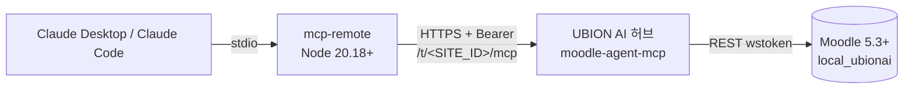

# Claude(Desktop / Code)를 UBION AI Moodle MCP에 연결하기

> 대상: Moodle 관리자(플러그인 설치·허브 등록)와 교직원(Claude 연결). 기준: `local_ubionai` 0.5.1 (2026103106), 커밋 `47cc0caa`, 작성일 2026-11-01.
> 이 문서에는 토큰·비밀값·실서버 주소가 없습니다. `<...>` 는 모두 바꿔 넣을 값입니다.

## 1. 구성



- **Moodle 쪽**: `local_ubionai` 플러그인이 웹서비스·서비스 사용자(`svc_ubionai`)·역할·외부 서비스·토큰을 만들고 허브에 등록합니다.
- **허브**: Moodle 토큰을 암호화해 보관하고, 테넌트별 MCP 엔드포인트 `https://<HUB_HOST>/t/<SITE_ID>/mcp` 를 Bearer 인증으로 엽니다(도구 39개, 쓰기 도구는 미리보기 → 승인 → 실행 2단계).
- **Claude 쪽**: Claude가 `mcp-remote` 를 stdio 서버로 띄우고, `mcp-remote` 가 허브에 Bearer 헤더로 접속합니다.

## 2. 다운로드

| 무엇 | 링크 | 비고 |
|---|---|---|
| 플러그인 repo (공개) | https://github.com/scottnaddle/moodle-local_ubionai | |
| 플러그인 main zip | https://github.com/scottnaddle/moodle-local_ubionai/archive/refs/heads/main.zip | 최신 main. 내용이 바뀔 수 있음 |
| 플러그인 커밋 고정 zip (0.5.1) | https://github.com/scottnaddle/moodle-local_ubionai/archive/47cc0caac87e95d9c7e400f855c2ce515313c6db.zip | 운영 설치에 권장 |
| 플러그인 v0.5.1 태그 zip | **아직 없음** | 2026-11-01 확인: 태그·릴리스 0개. 제안: v0.5.1 태그·릴리스 생성 시 https://github.com/scottnaddle/moodle-local_ubionai/archive/refs/tags/v0.5.1.zip |
| 허브 repo (비공개) | https://github.com/scottnaddle/moodle-agent-mcp **(접근 권한 필요)** | 허브 운영자용. `client/moodle-mcp-remote.sh` 래퍼도 여기 있음 |

⚠️ **폴더 이름**: zip을 풀면 `moodle-local_ubionai-main` (커밋 zip은 `moodle-local_ubionai-47cc0caa…`) 폴더가 생깁니다. 이 폴더 이름을 반드시 **`ubionai`** 로 바꿔야 합니다. 이름이 다르면 Moodle이 플러그인을 인식하지 못합니다.

```bash
unzip moodle-local_ubionai-main.zip
mv moodle-local_ubionai-main ubionai
```

## 3. 플러그인 설치 (Moodle 관리자)

요구사항: Moodle 5.3 LTS 이상(`requires = 2026100500`).

1. `ubionai` 폴더를 `<MOODLE_ROOT>/public/local/ubionai` 에 둡니다(5.3의 `public/` 구조).
2. 업그레이드를 실행합니다: 사이트 관리 > 알림, 또는 `php admin/cli/upgrade.php`.
3. 0.5.0 이하에서 올리는 경우 플러그인 `README.md` 의 *Upgrading to 0.5.1* 절을 먼저 읽으세요.

## 4. 허브에 연결 (Moodle 관리자)

1. 허브 운영자에게 이 사이트용 **1회용 등록 코드**를 받습니다(운영자: `moodle-hub-admin issue-code --site-id <SITE_ID> --moodle-url <WWWROOT> --out <FILE>`). 코드는 채팅·메일 본문 대신 안전한 경로로 받으세요.
2. 사이트 관리 > 플러그인 > 로컬 플러그인 > *UBION AI connection* 에서 `Hub URL`(`https://` 로 시작)을 넣습니다.
3. `/local/ubionai/connect.php` 에서 등록 코드를 넣고 *Connect* 를 누르거나, CLI로 실행합니다.

   ```bash
   php local/ubionai/cli/connection.php --connect --regcode-file=-   # 코드를 stdin으로 (히스토리에 안 남음)
   php local/ubionai/cli/connection.php --status
   ```
4. 성공하면 상태 페이지에 **허브 사이트 ID, MCP 엔드포인트, 등록 시각, 허브 egress IP** 가 표시됩니다. MCP 엔드포인트(`https://<HUB_HOST>/t/<SITE_ID>/mcp`)를 적어 두세요. 허브가 돌려준 MCP bearer는 Moodle에 암호화 저장되고 **화면에 표시되지 않습니다**(5절 참고).

## 5. Claude용 MCP bearer 받기

Claude가 허브에 접속하려면 그 테넌트의 **MCP bearer** 가 필요합니다. 플러그인은 bearer를 보여 주지 않으므로 허브 운영자가 발급합니다.

- **허브(멀티테넌트) 모드**: 운영자가 `moodle-hub-admin rotate --site-id <SITE_ID> --new-bearer --bearer-out <FILE>` 로 새 bearer를 파일로 발급해 전달합니다. 테넌트당 bearer는 하나라서 **이전 bearer(플러그인에 저장된 것 포함)는 즉시 무효**가 됩니다. 여러 사람이 같은 bearer를 나눠 쓰게 된다는 점도 알아 두세요(아래 갭 목록 참고).
- **단일 서버 모드**(허브 없이 서버 하나): 엔드포인트는 `https://<MCP_HOST>/mcp`, bearer는 서버의 `MCP_BEARER_TOKEN` 값입니다.

받은 bearer는 내 PC에서 권한 600 파일로만 저장합니다.

```bash
mkdir -p ~/.config/moodle-mcp
(umask 077; cat > ~/.config/moodle-mcp/token)   # 붙여 넣고 Enter, Ctrl-D (히스토리에 안 남음)
chmod 600 ~/.config/moodle-mcp/token
```

## 6. 공통 준비 (Claude를 쓰는 PC)

- **Node.js 20.18 이상**(`node -v`). 최신 `mcp-remote` 는 Node 18에서 동작하지 않습니다. Ubuntu 24.04 apt의 nodejs(18)는 쓰지 말고 nodejs.org/NodeSource 배포본을 쓰세요.
- `mcp-remote` 버전을 하나 정해 고정합니다(`<MCP_REMOTE_VERSION>`, 예: `npm view mcp-remote version` 으로 확인한 값).
- 허브 인증서가 사설 CA라면 `NODE_EXTRA_CA_CERTS=<CA_CERT_PATH>` 를 환경변수에 추가합니다(Node는 OS 신뢰 저장소를 안 씀).

## 7. Claude Desktop

1. 설정 파일을 엽니다: Claude Desktop > Settings > Developer > *Edit Config*
   - macOS: `~/Library/Application Support/Claude/claude_desktop_config.json`
   - Windows: `%APPDATA%\Claude\claude_desktop_config.json`
2. 예시 파일의 `mcpServers.moodle` 항목을 붙여 넣고 `<...>` 를 채웁니다.
   - 예시: [claude_desktop_config.example.json](https://raw.githubusercontent.com/scottnaddle/moodle-local_ubionai/docs/claude-mcp-connect/docs/claude/claude_desktop_config.example.json)
   - `MCP_URL`: 4절의 MCP 엔드포인트, `MCP_TOKEN_FILE`: 5절 토큰 파일의 **절대 경로**(`~` 안 됨), `NPX`: `which npx` 결과의 절대 경로(Desktop 앱은 셸 PATH를 물려받지 않음).
   - 설정 파일에는 토큰이 아니라 **토큰 파일 경로만** 들어갑니다.
3. Claude Desktop을 완전히 종료 후 다시 실행합니다. 도구 아이콘(🔨)에 `moodle` 도구가 보이면 성공입니다.
4. 허브 운영자 권한이 있으면 `/bin/sh -c ...` 대신 허브 repo의 `client/moodle-mcp-remote.sh`(토큰 파일 권한 600 검사 포함)를 `command` 로 써도 됩니다.

> Windows: 예시는 `/bin/sh` 를 쓰므로 그대로는 동작하지 않습니다. WSL을 쓰거나, 운영자에게 Windows용 래퍼를 요청하세요(갭 목록 참고).

## 8. Claude Code

예시 스크립트를 내려받아 `<...>` 를 채운 뒤 실행합니다.

- 예시: [claude-code-mcp-add.example.sh](https://raw.githubusercontent.com/scottnaddle/moodle-local_ubionai/docs/claude-mcp-connect/docs/claude/claude-code-mcp-add.example.sh)

핵심 명령(권장, stdio + mcp-remote):

```bash
claude mcp add moodle --scope user \
  --env MCP_URL='<MCP_ENDPOINT_URL>' \
  --env MCP_TOKEN_FILE='<ABSOLUTE_PATH_TO_TOKEN_FILE>' \
  --env MCP_REMOTE_VERSION='<MCP_REMOTE_VERSION>' \
  -- /bin/sh -c 'AUTH_HEADER="Bearer $(tr -d "\r\n" < "$MCP_TOKEN_FILE")"; export AUTH_HEADER; exec npx -y "mcp-remote@$MCP_REMOTE_VERSION" "$MCP_URL" --transport http-only --header "Authorization:\${AUTH_HEADER}"'
claude mcp get moodle
```

- `--scope`: `local`(이 프로젝트, 나만), `project`(`.mcp.json` 으로 팀 공유 — 경로만 들어가고 토큰은 안 들어감), `user`(모든 프로젝트).
- 대안: `.mcp.json` 에 `"type": "http"`, `"headers": {"Authorization": "Bearer ${MOODLE_MCP_TOKEN}"}` 처럼 **환경변수 치환**으로 직접 HTTP 연결도 가능합니다(예시 파일 2번).
- ❌ `claude mcp add --transport http ... --header "Authorization: Bearer <실제토큰>"` 은 쓰지 마세요. 토큰이 셸 히스토리와 `~/.claude.json` 에 평문으로 남습니다.
- Claude Code 안에서 `/mcp` 로 연결 상태(connected/failed)를 볼 수 있습니다.

## 9. 동작 확인

Claude에게 다음처럼 요청합니다.

1. "moodle 도구로 site_info 보여 줘" → 사이트 이름과 서비스 사용자(`svc_ubionai`)가 나오면 연결 성공.
2. "list_courses 로 강좌 목록 5개만" → 읽기 도구 확인.
3. 쓰기 도구(`create_*`, `update_*`, `set_*` 등)는 먼저 `confirm=false` 미리보기를 보여 주고, 사람이 승인한 뒤 `confirm=true` 로 실행됩니다. **처음에는 테스트 강좌에서만** 시험하세요.
4. 허브에서 가명 처리(pseudonymize)가 켜져 있으면 학생 이름·이메일이 가명으로 보이는 것이 정상입니다.

## 10. 문제 해결

| 증상 | 원인 / 조치 |
|---|---|
| `401 unauthorized` | Authorization 헤더가 없음. 토큰 파일 경로·권한 확인 |
| `403 forbidden` | bearer가 틀렸거나 회전(rotate)됨, 또는 엔드포인트의 `<SITE_ID>` 가 다름. 운영자에게 재발급 요청 |
| `404 not found` | 엔드포인트 경로 오류. 허브는 `/t/<SITE_ID>/mcp`, 단일 서버는 `/mcp` |
| `File is not defined` / 즉시 종료 | Node 18. Node 20.18+ 설치 |
| Desktop에서 `npx: not found` / `spawn ... ENOENT` | 예시의 `NPX` 에 `which npx` 절대 경로 지정 |
| 인증서 오류(`UNABLE_TO_VERIFY_LEAF_SIGNATURE` 등) | `NODE_EXTRA_CA_CERTS` 지정 |
| 도구가 옛 목록 그대로 | 클라이언트를 완전히 재시작하거나 서버를 삭제 후 다시 추가. 그래도 같으면 새 이름(예: `moodle2`)으로 추가 |
| 특정 도구만 `error` + `hint` | 선택 플러그인(mod_attendance, mod_openmaic) 미설치. 정상 동작 |
| 로그 | macOS Desktop: `~/Library/Logs/Claude/mcp-server-moodle.log` |

## 11. 보안 체크

- bearer는 600 파일에만. 설정 파일·명령줄·채팅·이슈·PR에 붙여 넣지 않기.
- PC를 바꾸거나 퇴사·분실 시 운영자에게 `rotate --new-bearer` 요청.
- 운영 데이터에 쓰기 전에 테스트 강좌/스테이징에서 먼저 확인.
- Claude에 입력·조회한 Moodle 데이터(이름, 이메일, 성적, 제출물 등)는 허브와 LLM 처리자에게 전송됩니다(플러그인 Privacy 절). 기관 정책을 확인하세요.

## 12. 예시 파일 (raw 링크)

> 아래 링크는 draft PR 브랜치(`docs/claude-mcp-connect`) 기준입니다. **draft PR 머지 후 main 경로로 바뀝니다**(`.../moodle-local_ubionai/main/docs/claude/<파일>`).

- https://raw.githubusercontent.com/scottnaddle/moodle-local_ubionai/docs/claude-mcp-connect/docs/claude/claude_desktop_config.example.json
- https://raw.githubusercontent.com/scottnaddle/moodle-local_ubionai/docs/claude-mcp-connect/docs/claude/claude-code-mcp-add.example.sh
- https://raw.githubusercontent.com/scottnaddle/moodle-local_ubionai/docs/claude-mcp-connect/docs/claude/README.md
- https://raw.githubusercontent.com/scottnaddle/moodle-local_ubionai/docs/claude-mcp-connect/docs/claude/GUIDE-ko.md

## 13. 알려진 갭

1. **v0.5.1 태그·릴리스 없음** — 고정 다운로드는 커밋 zip만 가능.
2. **bearer를 사용자에게 줄 공식 경로 없음** — 플러그인은 bearer를 표시하지 않고, 허브는 테넌트당 bearer 1개라서 운영자가 `rotate --new-bearer` 로 재발급해야 하며 이때 플러그인에 저장된 bearer가 무효화됨. 사용자별 bearer·감사 추적도 없음.
3. **OAuth 미지원** — claude.ai 웹/Desktop의 *Connectors(원격 커스텀 커넥터)* 로는 연결 불가, `mcp-remote` stdio 방식만 가능.
4. **Windows 예시 없음** — 예시는 `/bin/sh` 기반, 허브의 래퍼도 bash.
5. **래퍼 스크립트가 비공개 repo에 있음** — `client/moodle-mcp-remote.sh` 는 허브 repo(접근 권한 필요). 공개 예시는 동일 동작을 인라인 `sh -c` 로 대체.
6. **Claude 클라이언트 실연결 미검증** — 이 문서의 셸 조각은 가짜 `npx` 로 인자/환경변수 전달만 확인했고, 실제 허브·Claude Desktop/Code 로 end-to-end 시험은 하지 않음.
